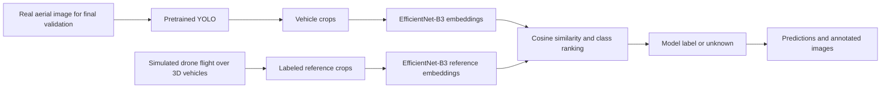
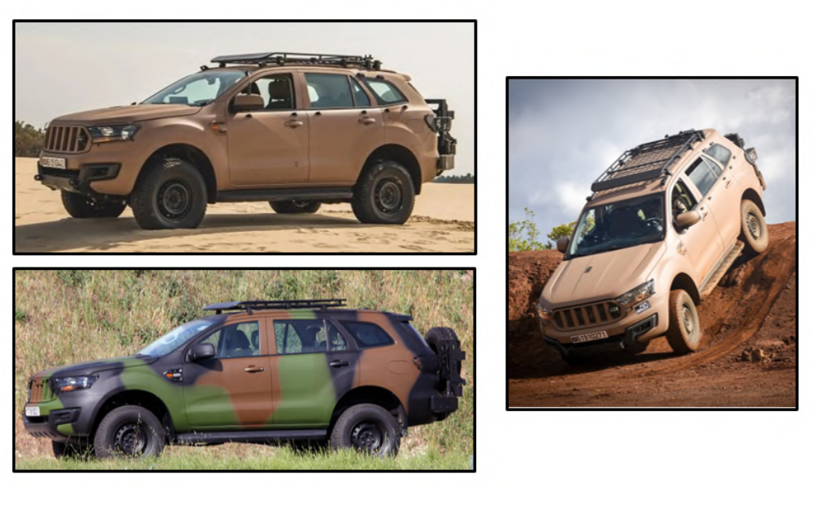
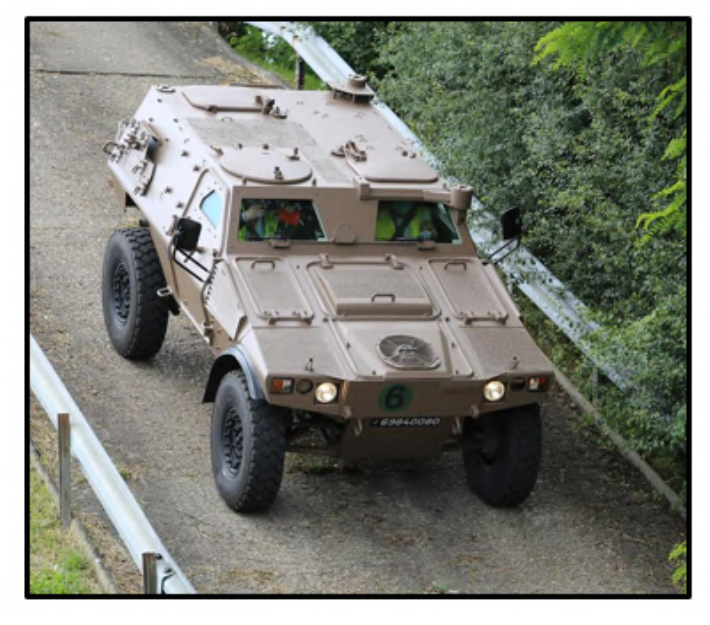
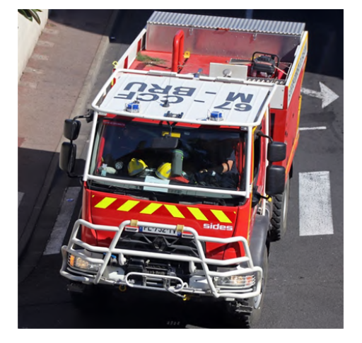
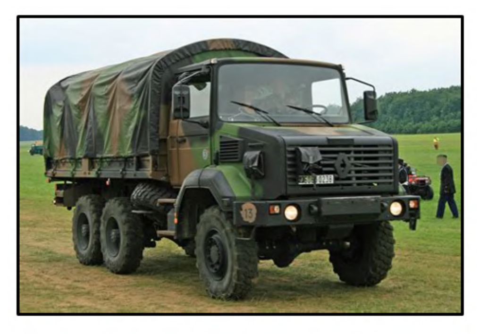
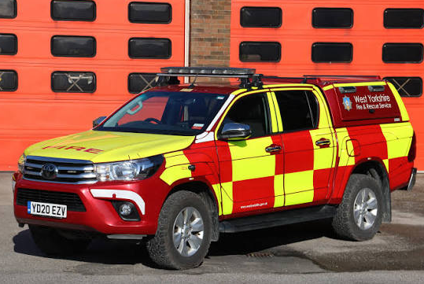

# Aerial Vehicle Recognition

Offline recognition of specific operational vehicle models in aerial images using pretrained YOLO detection, EfficientNet-B3 visual embeddings, and a labeled reference gallery.

**Status:** architecture and environment scaffold. Configuration inspection and the reference gallery are available. Model inference, asset preparation, augmentation, and evaluation are planned interfaces; their Python modules currently document responsibilities rather than implement the pipeline.

## Context and problem definition

Aerial vehicle recognition involves two different tasks: locating a vehicle in an image and identifying its specific model. In a forest environment, vegetation, shadows, partial occlusion, viewing angle, and object scale can obscure the details needed for recognition. Models with similar silhouettes can be difficult to distinguish, while vehicles of the same model can look different across viewpoints and configurations.

Public datasets provide useful knowledge for vehicle detection, but no single dataset can be assumed to cover every deployment condition. Their cameras, environments, perspectives, and class definitions can differ from those of a real application. A detector that recognizes broad categories such as `car` or `truck` does not automatically recognize the particular operational vehicle models required in a new setting.

Building a comprehensive custom detection dataset requires access to vehicles, representative image collection, annotation, and repeated maintenance. This project investigates a more economical initial adaptation: reuse pretrained visual networks and introduce application-specific vehicle models through a smaller labeled reference gallery. The approach starts without requiring real-flight footage of the target vehicles to construct that gallery.

**The initial reference images were generated by flying a simulated drone over 3D models of the five target vehicles and cropping the resulting vehicle detections.** These simulated aerial observations provide labeled examples for reference-based recognition without first collecting a custom gallery through real flights. The included gallery also contains augmented variants of those crops.

The final evaluation uses **real drone footage of vehicles in a forest**, supplied as still images and managed and annotated in the Roboflow project `drone-forest-vehicles`. These images are reserved for final validation rather than used to build the initial reference gallery. This separation makes the experiment a test of transfer from simulation-generated references to real aerial observations, including differences in rendering, appearance, lighting, vegetation, and occlusion.

The objective is to measure how robustly pretrained representations and reference-based recognition transfer to these conditions while reducing the initial need for a comprehensive custom training dataset. Simulation does not remove the difference between synthetic and real imagery: robustness, generalization, and annotation savings are hypotheses to evaluate, not established results.

## Proposed technique

The recognition pipeline combines a pretrained vehicle detector with an EfficientNet-B3 embedding extractor:

1. **Detect:** YOLO locates candidate vehicles and reports bounding boxes and detection confidence.
2. **Crop:** extract each vehicle region, with a configurable margin clipped to the image boundaries.
3. **Represent:** EfficientNet-B3 produces a visual feature vector for the crop. Its classification layer is excluded, its pooled features are flattened, and the resulting 1,536-dimensional vector is L2-normalized.
4. **Compare:** use the same extractor and preprocessing for reference images, then compare the observed embedding against individual reference embeddings using cosine similarity.
5. **Recognize:** assign each class the highest similarity among its reference examples, rank the classes, and return `unknown` if the best score falls below the acceptance threshold.
6. **Report:** save per-vehicle predictions, annotated images, timing, and the configuration needed to reproduce the experiment.



The central recognition module is `src/vehicle_recognition/similarity_efficientnet.py`. It will contain the feature extractor, reference database, cosine matching, and detector/recognizer integration. The surrounding modules handle datasets, offline orchestration, augmentation, and reporting.

The extractor uses the official public torchvision checkpoint **`EfficientNet_B3_Weights.IMAGENET1K_V1`**, pretrained on ImageNet-1K. No additional trained projection head is required. ImageNet pretraining supplies general visual representations; the labeled gallery supplies the association with the specific vehicle models. The checkpoint's preprocessing preset will be applied consistently to both reference and query images. See the [official EfficientNet-B3 documentation](https://docs.pytorch.org/vision/stable/models/generated/torchvision.models.efficientnet_b3.html).

The initial detector candidate is the community [YOLOv8s checkpoint fine-tuned on VisDrone](https://huggingface.co/dronefreak/visdrone-yolov8s). Detector weights and the dataset used to train them are separate assets: using the weights does not require downloading VisDrone.

### Demonstration vehicles and simulated references

The illustrations below show the five vehicle types represented by the simulation's 3D models and used to demonstrate the recognition approach. They are documentation illustrations; the recognition gallery consists of the simulated aerial crops described above.

| Label | Initial reference images (simulation, including augmentation) | Vehicle illustration |
| --- | ---: | --- |
| `arquus_vt4` | 30 |  |
| `panhard_vbl` | 13 |  |
| `renault_ccfm` | 8 |  |
| `renault_gbc180` | 13 |  |
| `vltt` | 19 |  |

These 83 simulation-derived starter images are replaceable reference assets, not evaluation ground truth. There are no additional category groupings. `unknown` is a recognition outcome, not an extra catalog class.

Adding references and rebuilding their index can extend the recognition catalog without retraining the detector, provided that the detector localizes the relevant vehicles and the embeddings distinguish them. Detection confidence and cosine similarity are separate measurements; a similarity score is not a calibrated probability of correctness.

Optional reference augmentation and rotated-image inference are planned. Rotated detections must be transformed back to the original coordinates and deduplicated before reporting. The initial scope is offline still images; image ordering alone does not establish that detections show the same physical vehicle.

## Folder structure

```text
.
├── README.md
├── Dockerfile
├── .dockerignore
├── .gitignore
├── .env.example
├── pyproject.toml
├── requirements.txt
├── configs/
│   ├── default.yaml                 # Recognition, detector, device, and paths
│   ├── classes.yaml                 # Canonical five-class recognition catalog
│   └── datasets.yaml                # Roboflow and optional VisDrone sources
├── src/vehicle_recognition/
│   ├── __main__.py                  # python -m vehicle_recognition
│   ├── cli.py                       # Scaffold/configuration inspection
│   ├── similarity_efficientnet.py    # Planned EfficientNet-B3 recognition core
│   ├── reference_dataset_augmentation.py
│   ├── datasets.py
│   ├── pipeline.py
│   ├── evaluation.py
│   └── reporting.py
├── notebooks/                       # Planned dataset exploration and figures
├── docs/
│   ├── backlog.md
│   └── images/vehicles/             # Vehicle illustrations embedded above
├── data/
│   ├── reference_dataset/<label>/    # Versioned simulated aerial reference crops
│   ├── forest_vehicles/             # Ignored Roboflow export
│   └── visdrone/                    # Ignored optional public dataset
├── artifacts/
│   ├── weights/                     # Ignored downloaded model weights
│   ├── reference_indexes/           # Ignored generated gallery embeddings
│   └── cache/                       # Ignored persistent download caches
└── outputs/<run_id>/                # Ignored experiment results
```

The recognition catalog and detector taxonomy are separate. `classes.yaml` defines the five specific models. The YOLO checkpoint defines its own broad classes; vehicle filtering must resolve their names to the checkpoint's IDs. The Roboflow export's `data.yaml` must retain its actual class order, with names checked against the recognition catalog rather than IDs assumed to match.

## Setup for experiments

### Desktop environment

The target is Linux x86-64 with Python 3.10 and either CPU execution or NVIDIA CUDA. The core version baseline matches the inspected desktop environment: **PyTorch 2.9.1, torchvision 0.24.1, and Ultralytics 8.3.232**. The same application supports both backends. The remaining dependencies have bounded versions; `requirements.txt` is not a complete transitive lockfile.

Docker installs its own virtual environment at `/opt/venv`. The host Python environment is not copied into the image. The GPU build uses the pinned PyPI PyTorch 2.9.1 release for Linux x86-64, which supplies CUDA 12.8, and checks the compiled CUDA version during the build. The CPU build uses the official CPU wheel index. NVIDIA drivers and NVIDIA Container Toolkit remain host requirements. An RTX 4050 with 6 GB VRAM and driver 570.211.01 is the initial hardware baseline, not a minimum GPU specification. See the [official PyTorch installation matrix](https://pytorch.org/get-started/previous-versions/).

Build for CPU:

```bash
docker build --build-arg TORCH_BACKEND=cpu -t aerial-vehicles:cpu .
```

Or build for CUDA 12.8:

```bash
docker build --build-arg TORCH_BACKEND=cu128 -t aerial-vehicles:cuda .
```

If downloads stall with Docker's default build networking on Linux, add `--network=host` to the build command.

Check the configuration and reference counts:

```bash
docker run --rm aerial-vehicles:cpu status
```

Check GPU visibility from inside the CUDA container:

```bash
docker run --rm --gpus all aerial-vehicles:cuda status --check-runtime
```

Runtime selection is configured as `auto`, `cpu`, or `cuda`. The planned pipeline will resolve `auto` using CUDA availability inside the running environment, and an explicit `cuda` request will fail clearly if CUDA is unavailable.

For a local environment without Docker:

```bash
/usr/bin/python3 -m venv .venv
source .venv/bin/activate
python -m pip install --upgrade pip setuptools wheel
python -m pip install torch==2.9.1 torchvision==0.24.1 --index-url https://download.pytorch.org/whl/cpu
python -m pip install -r requirements.txt
python -m pip install --no-deps --no-build-isolation -e .
python -m vehicle_recognition status
```

For a local CUDA environment, install the pinned releases from PyPI instead of the CPU index: `python -m pip install torch==2.9.1 torchvision==0.24.1 --index-url https://pypi.org/simple`. Dependencies belong in the project environment; installing unrelated packages into the host Python is not required.

### Data and asset configuration

Copy the environment template when using Roboflow:

```bash
cp .env.example .env
```

Set `ROBOFLOW_WORKSPACE`, `ROBOFLOW_VERSION`, and `ROBOFLOW_API_KEY` locally. `ROBOFLOW_PROJECT` is already `drone-forest-vehicles`. The workspace and dataset version are intentionally unset. Keep credentials in the ignored `.env` file. See the [Roboflow dataset download documentation](https://docs.roboflow.com/datasets/create-and-upload/download-a-dataset.md).

Dataset exports, model weights, indexes, and results stay outside Git history. The small reference gallery is included so it can be reviewed and replaced. Large ZIP archives are excluded from Git and the Docker build context.

Persist local assets when running the container:

```bash
docker run --rm --env-file .env \
  --mount type=bind,src="$PWD/data",dst=/app/data \
  --mount type=bind,src="$PWD/artifacts",dst=/app/artifacts \
  --mount type=bind,src="$PWD/outputs",dst=/app/outputs \
  aerial-vehicles:cpu status
```

Use `--gpus all` and the CUDA image for GPU execution. The preparation stage will write downloaded datasets; inference can mount its input dataset read-only.

### Planned experiment sequence

The following describes the implementation target. **Only `status` is currently executable; the experiment commands below are not yet implemented.**

| Planned operation | Purpose |
| --- | --- |
| `prepare` | Cache the YOLO and official EfficientNet-B3 weights; optionally download the configured Roboflow version |
| `prepare --include-visdrone` | Also download and convert VisDrone for exploratory analysis |
| `augment-references` | Generate optional variants of reference crops |
| `index` | Build embeddings and record the extractor, preprocessing, and gallery fingerprints |
| `predict` | Run detection and similarity recognition on offline images |
| `evaluate` | Compare saved predictions against the annotated evaluation dataset |

The real forest dataset is reserved for final evaluation; the initial gallery is generated in simulation. Gallery examples and threshold calibration must remain independent of the final evaluation data. Each run will preserve the selected detector, extractor checkpoint, preprocessing, gallery fingerprint, thresholds, device, predictions, and timing. Planned reports separate missed detections, model confusions, and incorrect acceptance of unknown vehicles, allowing the robustness of transfer from simulation to real flights to be assessed.

VisDrone download is optional and disabled by default. It will support exploratory analysis of class frequencies, bounding-box sizes, and example scenes for presentation figures. Its broad detection labels are distinct from the five-model recognition catalog. See the [VisDrone dataset and download configuration](https://docs.ultralytics.com/datasets/detect/visdrone/).

## Planned extensions

Training a detector on DroneVehicle is future work. It will provide a second detector for experiments using the same similarity-recognition stage. The current scaffold neither downloads DroneVehicle nor trains a detector. Additional implementation tasks are tracked in [docs/backlog.md](docs/backlog.md).
